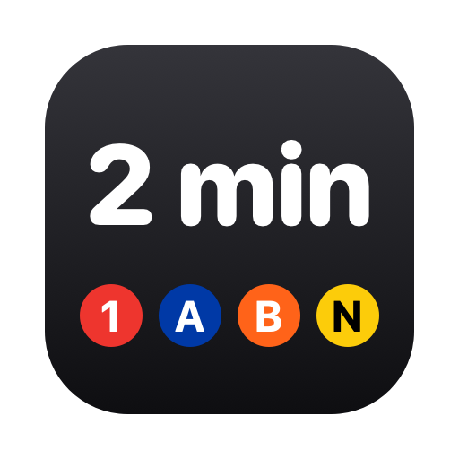

<p align="center"></p>

# MTA Bar

A macOS menu bar countdown for NYC subway arrivals. Pick the stations, directions, and lines you care about, and the menu bar shows the next train, e.g. **(C) in 4m**.

- Live data from the MTA's real-time subway feeds (no API key needed), refreshed every 30 seconds
- Save multiple stations; pin one to the menu bar, or let it follow your location and show the nearest saved station
- Station search that understands MTA abbreviations ("union square", "57th st n")
- Requires macOS 15 or later; runs on Apple Silicon and Intel

## Install

### Homebrew (recommended)

```sh
brew install --cask zakarlyya/tap/mtabar
```

Update with `brew upgrade --cask mtabar`.

### Download

1. Download `MTABar.zip` from the [latest release](https://github.com/zakarlyya/mta/releases/latest), unzip it, and move **MTABar.app** to Applications.
2. Open it. macOS will block it because the app isn't notarized by Apple.
3. Go to **System Settings → Privacy & Security**, scroll down, and click **Open Anyway**.

Or skip step 3 by running:

```sh
xattr -dr com.apple.quarantine /Applications/MTABar.app
```

### Build from source

Requires the Xcode Command Line Tools (`xcode-select --install`).

```sh
git clone https://github.com/zakarlyya/mta.git
cd mta
./build.sh --install
```

## Development

- `./build.sh --install` builds and installs to `~/Applications`
- `./release.sh 1.0.1` publishes a GitHub release and updates the Homebrew cask
- `python3 tools/gen_stations.py` regenerates station data from the MTA's static GTFS
- `swift tools/make_icon.swift` regenerates the app icon

Data © Metropolitan Transportation Authority. Not affiliated with the MTA.
